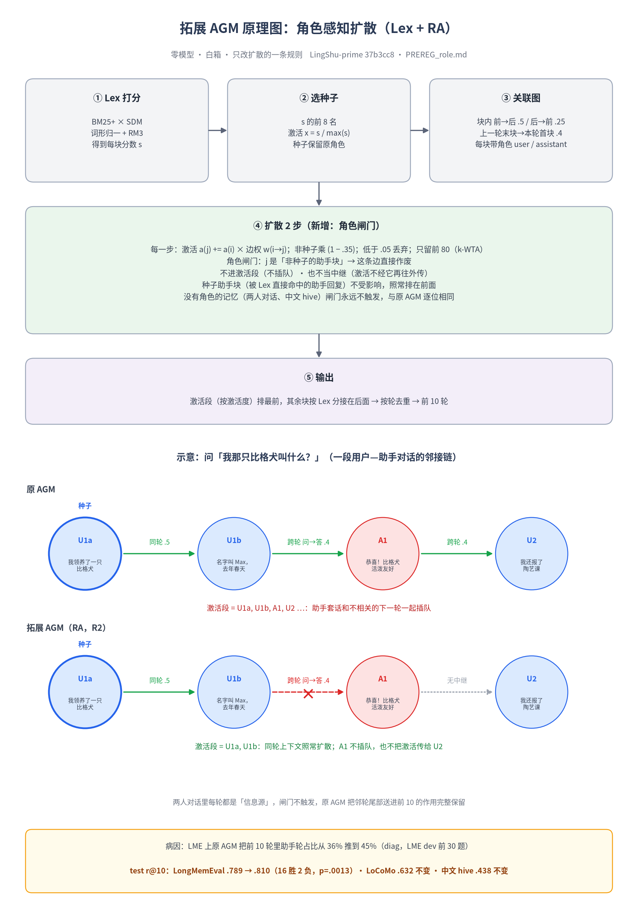

# TanPowasd · 灵枢（Lingshu）记忆算法工作区

> 面向上游 [FuRongJun-1999/lingshu](https://github.com/FuRongJun-1999/lingshu) 的自有算法、方案与实现。
> **零模型、零 key 可复跑**是默认要求：每个结论都附预注册、复跑命令和逐题读数，说不清的写「存疑」，推断写「推断」。



## 一眼看懂：当前推荐栈

```
写入 ─▶ Lex 打分（BM25+ δ1 × SDM + 拉丁词形归一 + RM3）
      ─▶ RA-AGM 角色感知图扩散（非种子的助手段不扩散、不中继）
      ─▶ 中文：RA-AGM_zh（去疑问/虚字二元组 + 中文问句不做 RM3）
      ─▶ 状态类问题：逻辑链条路由（编年版本链排头）
```

| 场景 | 用哪个 | 位置 |
|---|---|---|
| 英文长对话记忆（LongMemEval / LoCoMo） | Lex + RA-AGM | [`agm/lex/`](agm/lex/) |
| 中文检索 | RA-AGM_zh | [`agm/zh/`](agm/zh/) |
| 中文「现在是什么 / 改过几次」 | RA-AGM_zh + 逻辑链条 | [`agm/zh/chain.py`](agm/zh/chain.py) |
| 接进 dsh-memory 的 md_cg | md_cg × TriCue（`MDCG_TRICUE=1`，缺省关） | [`agm/mdcg_tricue/`](agm/mdcg_tricue/) |

## 主要读数（test / 保留集，均零 key）

| 基准 | 指标 | 基线 | 我们 | 配对胜/负 | 来源 |
|---|---|---:|---:|---:|---|
| LongMemEval-S | r@10 | v3 .757 | **Lex+RA-AGM .810** | Lex→+RA 16/2，p=.0013 | [`agm/lex/PREREG_role.md`](agm/lex/PREREG_role.md) |
| LoCoMo | r@10 | v3 .618 | **Lex+RA-AGM .632** | Lex vs v3 116/84，p=.028 | [`agm/lex/PREREG.md`](agm/lex/PREREG.md) |
| CMRC 2018（中文，3219 题） | hit@1 | 做 RM3 .633 | **不做 RM3 .739** | 420/76，p≈1e-58 | [`agm/zh/PREREG_zh_rm3.md`](agm/zh/PREREG_zh_rm3.md) |
| 中文状态链（种子 4） | 单段题 hit@1 | RA-AGM_zh .739 | **+逻辑链 1.000** | 首轮 214/0 | [`agm/zh/PREREG_zh.md`](agm/zh/PREREG_zh.md) |
| hive-memory-bench 主轮 | 覆盖 @8000 | v3 .496，旧 AGM .522 | RA-AGM_zh .511 | — | 已看过的集，只作记录 |

诚实边界：
- 纯 Lex（不接 AGM）在 LongMemEval 上 .822，高于 Lex+RA-AGM；AGM 的收益目前主要在 LoCoMo（纯 Lex .558 → .632）。
- hive 上 RM3 的方向在 dev / test 之间翻转，中文 RM3 的裁决依据是 CMRC；CMRC 是百科事实题，向长篇叙事外推**存疑**。
- 逻辑链条依赖固定的中文变更动词表；表外说法交给 `agm/learn` 自举，真实改写尚未全面检验。

## 目录地图

### 检索主线 `agm/`
| 目录 | 内容 |
|---|---|
| [`lex/`](agm/lex/) | Lex 打分器、RA-AGM（`role.py`）、诊断与各次失败尝试（AX / PPR / CC / TM 等，均有预注册） |
| [`zh/`](agm/zh/) | RA-AGM_zh、逻辑链条、hive / CMRC / 状态链评测 |
| [`tricue/`](agm/tricue/) | TriCue（近因 / BM25 / AGM 三路线索），v3 冻结版；`rrf3/` 为旧名兼容层 |
| [`mdcg_tricue/`](agm/mdcg_tricue/) | 接进 dsh-memory md_cg 召回链的 opt-in 融合 |
| [`bench/`](agm/bench/) | hive / LongMemEval / LoCoMo 评测脚本与读数 |
| [`confluence/`](agm/confluence/) | 汇流：多维来源图与 QMD（需 LLM 抽取，非默认） |

### 记忆四能力套件（零模型）
| 能力 | 目录 | 一句话 |
|---|---|---|
| 联想 | [`agm/assoc/`](agm/assoc/) | 两跳扩散 + 多线索汇流 + 中枢词抑制 |
| 推理 | [`agm/reason/`](agm/reason/) | 中文状态变更句法 → 编年版本链 → 题面路由 |
| 自主学习 | [`agm/learn/`](agm/learn/) | 从已懂句子自举新说法，≥2 槽才晋升；可选 LLM 插件（缺省关） |
| 概念链 | [`agm/concept/`](agm/concept/) | 分类公式 DAG 原型（冲突策略待定） |

### 其他
| 目录 | 内容 |
|---|---|
| [`chronicle/`](chronicle/) · [`chronicle_dm/`](chronicle_dm/) | 编年版本链核心与编年判别记忆 |
| [`discriminative_memory/`](discriminative_memory/) | 通用判别记忆实验（结构化证据选择） |
| [`lspi/`](lspi/) | 枢接口原型：身体库 × 大脑库插件化拆分（待办第 9 项） |
| [`oracle_rd/`](oracle_rd/) | 检索层 R / 交付层 D 瓶颈 oracle 实验（一次性带 key；结论：瓶颈在检索） |
| [`proposals/`](proposals/) | 提案、任务书与 issue 草稿 |

## 快速复跑

```bash
# 推荐用 python 直接调用，避免编码问题
export PYTHONUTF8=1

# 中文：守卫 + CMRC 裁决（数据自取 github.com/ymcui/cmrc2018，不入库）
python -X utf8 agm/zh/test_zh.py && python -X utf8 agm/zh/test_zh.py --mutate
python -X utf8 agm/zh/bench_cmrc.py <cmrc2018_dev.json> --arms on,off --out z.json

# 英文：Lex / RA-AGM 守卫
python -X utf8 agm/lex/test_lex.py --mutate
python -X utf8 agm/lex/test_role.py --mutate
```

更多复跑命令见各子目录 README 与预注册文件头。外部基准（hive-memory-bench、LongMemEval、LoCoMo、CMRC）的语料和答案键**不入库**，运行时从原仓库读取。

## 工作约定

- **先预注册，后看 test**：dev 选型、test 只跑一次；看过的集不再用来裁决。
- **守卫要能分辨**：每条修复配断言，并用定点变异证明「改回去就变红」。
- **不放宽断言、不改阈值、不跳测试**来求绿。
- 与上游 issue/PR 相关的工作先查 `../Liyang/upstream-watch/tracker.json`，避免重复提交；不改动其他贡献者的目录。
- 不入库：记忆数据、凭据、私有模块；示例只用假凭据。

## 命名

RRF3 已于 2026-10-11 改名 **TriCue**（类名 `TriCueMemory`）；旧名 `RRF3Memory` 与 `agm/rrf3/rrf3.py` 保留兼容。评测臂 ID（如 `rrf3v11`）与已发布评测包保持原样，便于复现。

## 授权

本目录适用仓库根目录的[全局授权声明](../LICENSE)：**需授权使用**。可在 GitHub 浏览、fork；运行、复制、修改、分发、纳入其他项目、用于模型训练等须事先取得书面授权（在本仓库提 issue 申请）。引用的上游 lingshu 代码仍按其 MIT 协议；外部基准数据各按其原许可。
